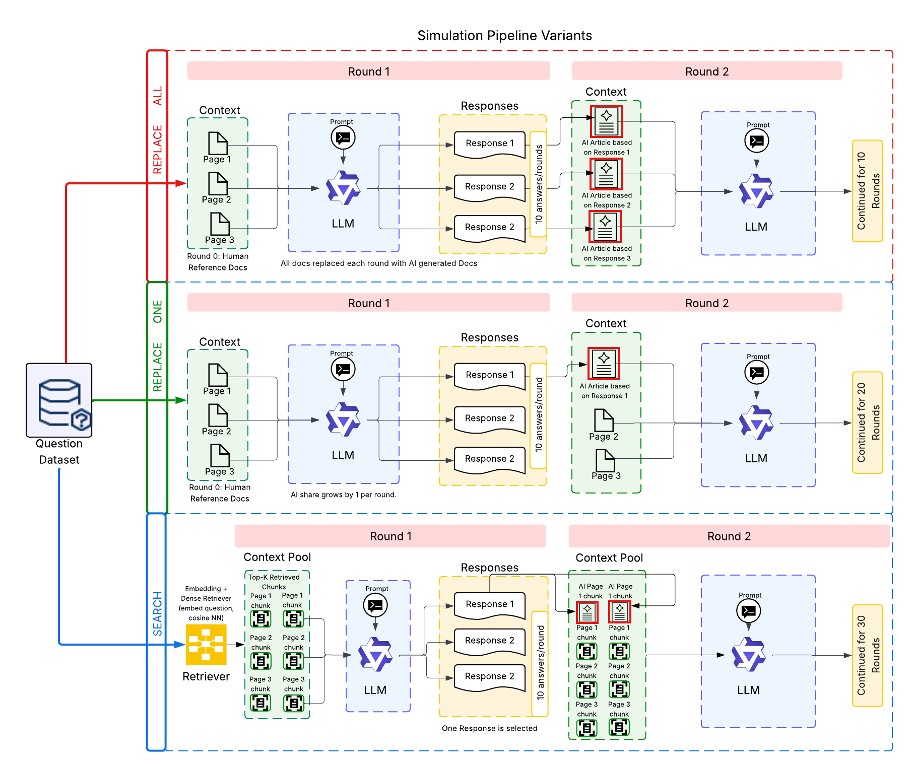
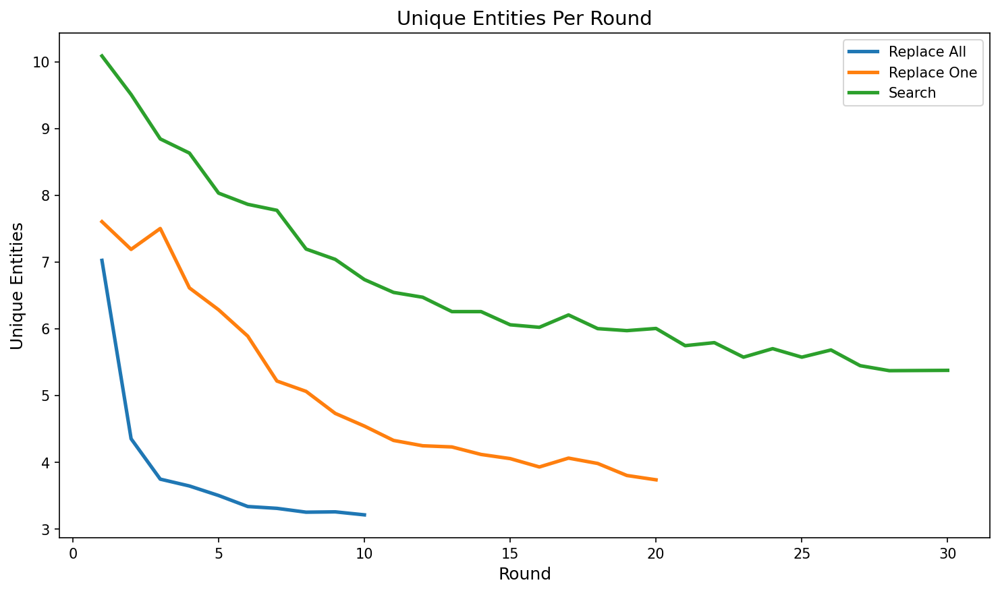
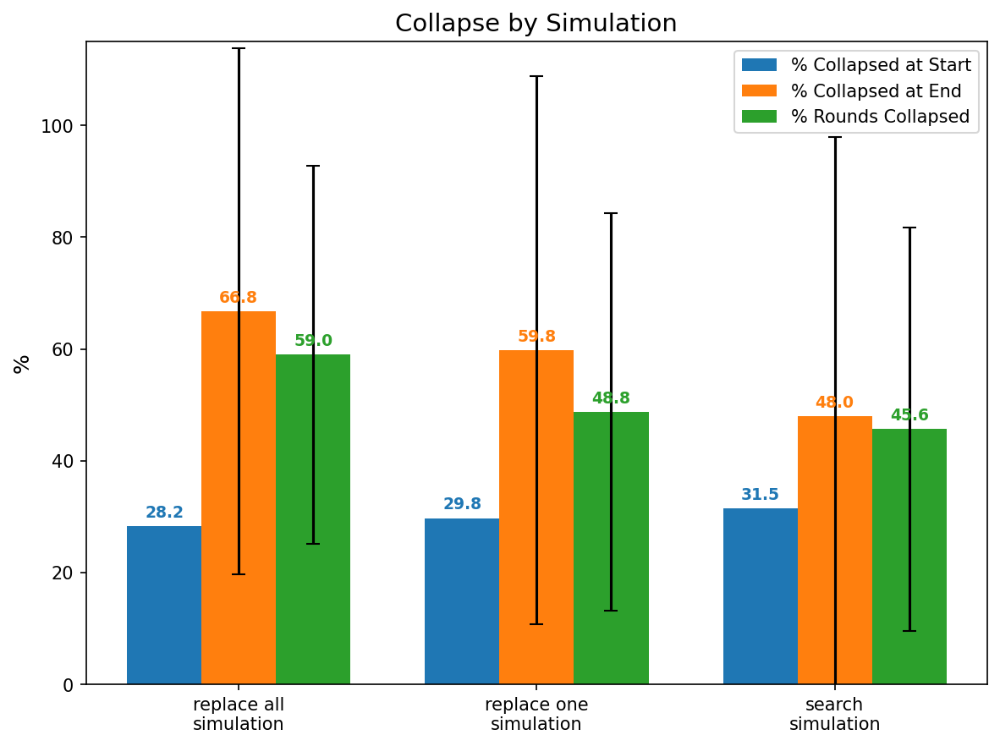
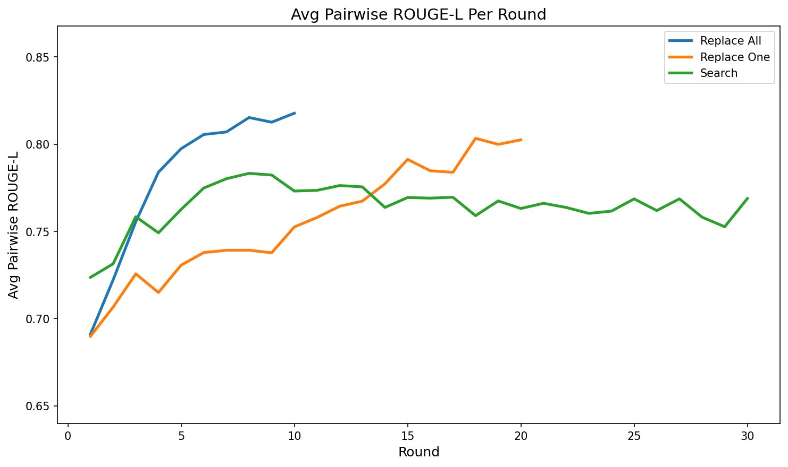
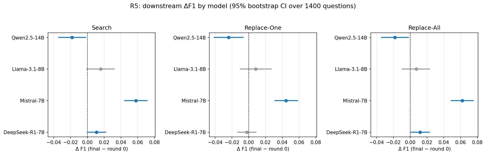
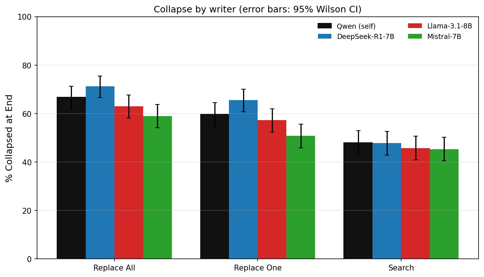
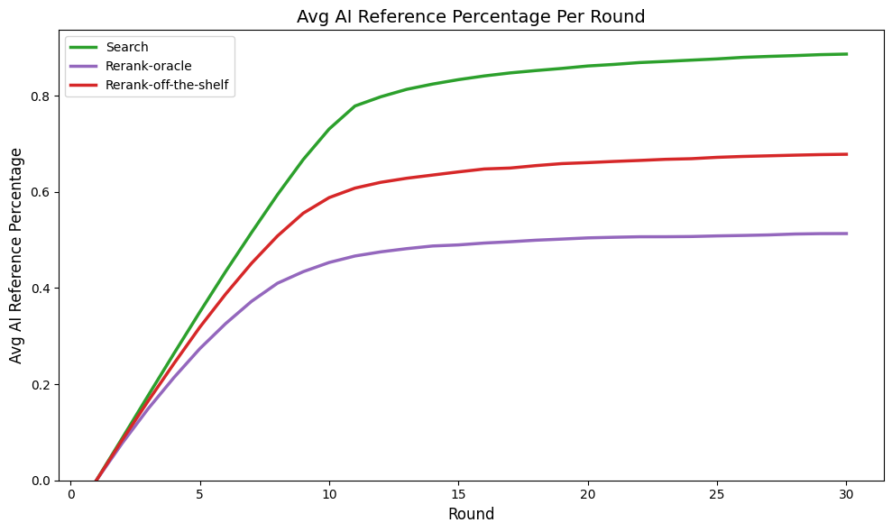
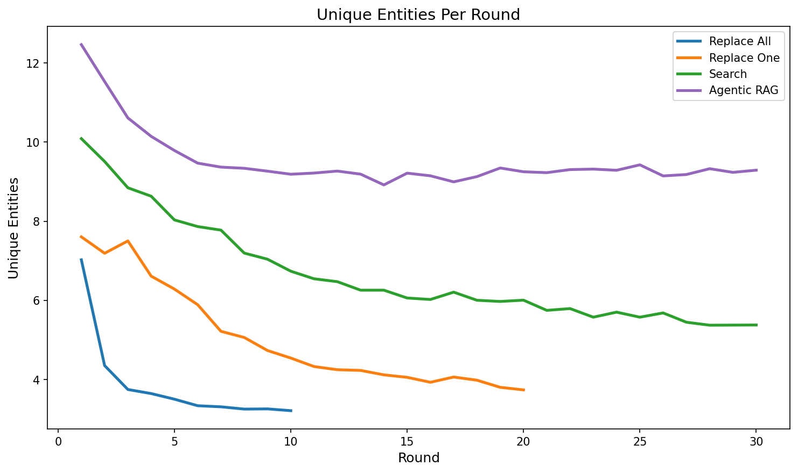
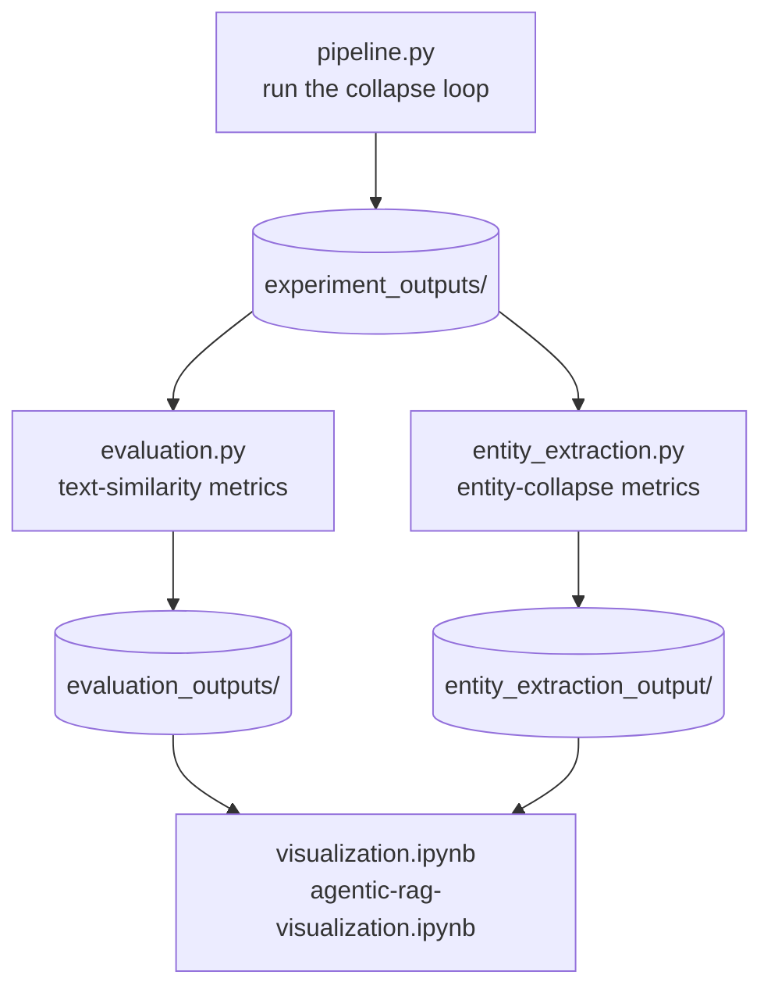
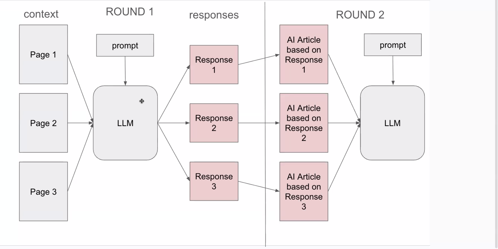

<h1 align="center">Does Retrieval Augmented Generation Collapse<br>When It Retrieves AI-Generated Documents?</h1>

<p align="center">
  <b>Riddhimaan Senapati</b><sup>1</sup> &nbsp;
  <b>Gregory Druck</b><sup>2</sup> &nbsp;
  <b>Fabeha Fatima</b><sup>1</sup> &nbsp;
  <b>Ozel Yilmazel</b><sup>1</sup> &nbsp;
  <b>Rati Rastogi</b><sup>1</sup> &nbsp;
  <b>Chang Zeng</b><sup>1</sup> &nbsp;
  <b>Ethan Smith</b><sup>2</sup>
  <br>
  <sup>1</sup>University of Massachusetts Amherst &nbsp;&nbsp; <sup>2</sup>Graphite
  <br><br>
  <i>GroundLM Workshop at EMNLP 2026, Budapest</i>
</p>

<p align="center">
  <a href="https://rag-collapse.github.io/RAG-Collapse/">Project page</a> ·
  <a href="#citation">Citation</a> ·
  <a href="#key-findings">Key findings</a> ·
  <a href="#reproducing-the-paper">Reproduce</a> ·
  <a href="#using-the-code">Code</a>
</p>

<p align="center">
  
</p>
<p align="center"><sub>
The three contamination simulations. From top to bottom: <b>Replace-All</b> (the entire context is replaced with generated documents after round 1), <b>Replace-One</b> (one reference is replaced per round), and <b>Search</b> (self-generated documents are gradually added to the question's reference pool and compete during retrieval).
</sub></p>

## Abstract

AI-generated text now constitutes a substantial and growing fraction of indexed web content, creating a feedback loop in which AI assistants may retrieve and condition on their own prior generations. Prior work shows that recursive *training* on model generations causes **model collapse**: a loss of output diversity and distributional drift. We ask whether a similar collapse emerges at *inference* time, when LLMs retrieve their own generations via RAG without any parameter updates. We measure collapse as the progressive convergence of responses to a narrow set across recursive retrieval rounds. Across three contamination simulations and four open-source LLMs, collapse is rapid and consistent under direct contamination, but partial and model-dependent under competitive retrieval. Collapse can also degrade downstream accuracy on factual multi-hop QA, though the effect is inconsistent across models. We further show that the self-generated documents we introduce are cited far above their share of the context, an effect that is not fully explained by document quality, writing style, AI authorship, or self-preference. Finally, we propose and evaluate mitigation strategies at both the retrieval and generation stages, none of which reliably prevent collapse. As AI-generated content continues to populate the open web, collapse-resistant retrieval design is necessary for trustworthy AI assistants.

## Key findings

- **RAG collapse is real and fast under direct contamination.** With Qwen2.5-14B-Instruct, 66.8% of entity-comparison questions are fully collapsed by the final round under Replace-All, 59.8% under Replace-One and 48.0% under Search, up from about 28–32% at the start.
- **The cause is an answer-derived preference.** At round 1, self-generated references are 12.0% of the context but receive 26.5% of citations (Replace-One). AI authorship, writing style, reference quality and self-preference do not account for it.
- **The effect on factual QA is model-dependent.** On HotpotQA only Qwen2.5-14B-Instruct loses F1 significantly. Mistral-7B-Instruct-v0.3 *gains* F1 as answers converge on a consensus.
- **No mitigation reliably prevents collapse.** Paraphrasing and agentic retrieval slow it, re-ranking is not effective, and GEPA prompt optimization did not improve over the baseline.

## Method

We use the controlled recursive-feedback design of Druck and Smith (2026). Each round, the model retrieves documents, answers the question 10 times, and one or more of those answers is rewritten into a web-style article (by Qwen2.5-7B-Instruct) that re-enters the retrieval pool. Questions are simulated independently.

| Simulation | What happens each round | Rounds |
|---|---|---|
| **Replace-All** | the entire context is replaced with AI-generated documents after round 1 | 10 |
| **Replace-One** | one original reference is replaced with a self-generated document | 20 |
| **Search** | one self-generated document is added to the question's pool and competes with the originals during retrieval | 30 |
| **Agentic RAG** | like Search, but the model decides what to retrieve via a `retrieve(query)` tool | 30 |

**Datasets.** 400 non-factoid entity-comparison questions (e.g. *"What are the best restaurants in the Bay Area?"*) from Druck and Smith (2026), and the first 1400 HotpotQA dev questions for factual multi-hop QA.

**Models.** Qwen2.5-14B-Instruct, Mistral-7B-Instruct-v0.3, Llama-3.1-8B-Instruct and DeepSeek-R1-Distill-Qwen-7B, all at temperature 0.7.

**Metrics.** Pairwise ROUGE-L and same-answer percentage (convergence), unique entities per round, collapse rate (a round is collapsed when every response mentions the same set of canonical entities), and token-level F1 on HotpotQA.

## Results

### Entity dataset: diversity collapses

<table>
  <tr>
    <td></td>
    <td></td>
    <td></td>
  </tr>
  <tr>
    <td align="center"><sub>(a) Unique entities per round</sub></td>
    <td align="center"><sub>(b) Collapse by simulation</sub></td>
    <td align="center"><sub>(c) Pairwise ROUGE-L per round</sub></td>
  </tr>
</table>

As the context becomes AI-generated, unique entities fall and responses grow more similar. Replace-All converges immediately, Replace-One more gradually, and Search most slowly, because self-generated and original references compete.

| Qwen2.5-14B-Instruct | Collapsed at start | Collapsed at end (95% Wilson CI) |
|---|---|---|
| Replace-All | 28.2% | **66.8%** [62.0, 71.2] |
| Replace-One | 29.8% | **59.8%** [54.9, 64.4] |
| Search | 31.5% | **48.0%** [43.1, 52.9] |

The same pattern holds for the other three models, most clearly under direct contamination (see the paper's appendix and `workshop_entity_visualizations/`).

### HotpotQA: accuracy effects depend on the model

HotpotQA answers are short factual spans, so response diversity is low to begin with and there is little room for collapse to cause an accuracy drop.

<p align="center"></p>

| ΔF1 (round 0 → final) | Replace-All | Replace-One | Search |
|---|---|---|---|
| Qwen2.5-14B | **−0.018** | **−0.024** | **−0.018** |
| Mistral-7B | **+0.062** | **+0.044** | **+0.058** |
| Llama-3.1-8B | +0.007 | +0.008 | +0.016 |
| DeepSeek-R1-7B | **+0.012** | −0.002 | +0.011 |

Bold cells have 95% bootstrap CIs (over 1400 questions) that exclude zero. Only Qwen declines significantly. Mistral significantly *improves* (DeepSeek only under Replace-All), consistent with collapse onto a consensus answer that raises token overlap for a low-baseline model. With 1400 questions the intervals are narrow, so the nulls are small effects rather than a lack of statistical power.

### What causes RAG collapse?

Collapse starts before the context is fully self-generated. Under Replace-One, unique words fall from 64.0 to 51.3 between rounds 1 and 9 while roughly half the context is still original references. We trace this to an **answer-derived preference**: the model conditions disproportionately on documents derived from model answers.

- **Self-generated references are over-cited.** At round 1 they are 12.0% of the context but receive 26.5% of citations under Replace-One (ratio 2.2), and 14.8% vs 24.0% under Search (ratio 1.6). A reference is credited only when regenerating the answer without it changes the answer (a leave-one-out counterfactual). The effect survives a query-alignment control and replicates across all four models and the agentic setting.

We then rule out four explanations:

| Hypothesis | Test | Result |
|---|---|---|
| ✕ AI authorship | split references into self-generated, AI-written (GPTZero) and human-written | mean citation rate 0.281 vs 0.123 vs 0.078: it tracks self-generation, not AI authorship |
| ✕ Writing style | paraphrase the original references into AI style before round 1 | collapse slows but still happens: style accelerates collapse but is not the sole cause |
| ✕ Reference quality | control for 8 GPT-5.2-judged quality dimensions | among top-scored references, self-generated ones are still cited 2.1× as often; with all 8 dimensions controlled the self-generation effect is +0.154 (p < 0.001) |
| ✕ Self-preference | build the fed-back documents from a *different* model's answers | collapse persists at a rate statistically indistinguishable from Qwen's own answers |

<p align="center"></p>
<p align="center"><sub>End-round collapse when the fed-back documents come from Qwen2.5-14B-Instruct's own answers vs. other models' answers.</sub></p>

### Mitigations

None of the mitigations reliably prevents collapse.

- **Re-ranking** penalizes likely-AI documents after retrieval, `s' = s · (1 − λ · P_AI(D))`, using an off-the-shelf detector or an oracle. It fails because it can only reorder what retrieval returns. By the final round, even the oracle retrieves on average only one original document out of ten.
- **Paraphrasing** the original references slows recursive self-reinforcement, but does not stop it.
- **Agentic RAG** ends at 27.2% collapsed vs 48.0–66.8% for the baselines, but it also starts much lower (7.2%) and makes about 1.01 tool calls per round. We can't attribute the gain to iterative retrieval rather than its richer system prompt.
- **GEPA prompt optimization** converged immediately: no candidate improved on the baseline prompt.

<table>
  <tr>
    <td></td>
    <td></td>
  </tr>
  <tr>
    <td align="center"><sub>AI reference % per round with re-ranking (HotpotQA, λ = 0.7)</sub></td>
    <td align="center"><sub>Agentic RAG vs. the three baselines (unique entities)</sub></td>
  </tr>
</table>

**Takeaway.** Because re-ranking can only reorder what retrieval returns, preventing collapse will likely require filtering self-generated references *before* retrieval and directly countering the answer-derived preference.

## Citation

If you use this code or data, please cite the paper. GitHub's "Cite this repository" button reads [`CITATION.cff`](CITATION.cff).

```bibtex
@inproceedings{senapati2026ragcollapse,
  title     = {Does Retrieval Augmented Generation Collapse When It Retrieves AI-Generated Documents?},
  author    = {Senapati, Riddhimaan and Druck, Gregory and Fatima, Fabeha and Yilmazel, Ozel and Rastogi, Rati and Zeng, Chang and Smith, Ethan},
  booktitle = {Proceedings of the Grounding Language Models (GroundLM) Workshop at EMNLP 2026},
  year      = {2026},
  url       = {https://github.com/rag-collapse/RAG-Collapse}
}
```

## Reproducing the paper

- **Datasets:** `datasets/umass_data.entity.chatgpt.{50,400}.jsonl` (the entity-annotated
  questions + reference documents that seed the loop).
- **Source-level citation labels / direct-elicitation data:** `evaluation_outputs/Qwen/citations/`
  (the "explicit" citation-elicitation outputs).
- **Camera-ready reanalysis:** `scripts/camera_ready/` regenerates
  the R4 (collapse vs contamination) and R5 (per-model ΔF1) figures under `camera_ready_outputs/`.
- **Paper figures:** `workshop-entity-visualization.ipynb` regenerates
  `workshop_entity_visualizations/`; `cross-model-baseline-visualization.ipynb` regenerates
  `cross_model_baseline_visualizations/`; the remaining figures used above are in `assets/paper/`.
- **Determinism:** generation runs at `temperature=0.7` with no fixed RNG seed, so runs are
  **not** bitwise-reproducible. Reproducibility rests on the released experiment/evaluation
  outputs and the 10-runs-per-round design. For deterministic reruns set `temperature=0` and a
  `seed` in the sampling params.

## Using the code

This repo runs the self-refinement loop under several document-update regimes, measures the
collapse, and tests mitigations (reranking, paraphrasing, agentic retrieval, and a
GEPA-optimized system prompt).

End-to-end workflow:



### Documentation

| Doc | What it covers |
|---|---|
| [`docs/unity_setup.md`](docs/unity_setup.md) | Unity HPC scratch-space setup + job submission workflow |
| [`docs/gepa_prompt_optimization_plan.md`](docs/gepa_prompt_optimization_plan.md) | GEPA system-prompt optimization: dataset, scoring, adapter, how to run |
| [`docs/gepa_flowchart.md`](docs/gepa_flowchart.md) | GEPA architecture & metrics as mermaid diagrams |
| [`docs/data_locations.md`](docs/data_locations.md) | Where every raw experiment JSON lives on Unity |
| [`scripts/all_experiments_README.md`](scripts/all_experiments_README.md) | The consolidated `all_experiments/` data tree (layout + scope) |
| [`docs/entity_extraction_comparison.md`](docs/entity_extraction_comparison.md) | Entity-extraction code vs the `collapse-randomness-research` repo |
| [`docs/pipeline_comparison.md`](docs/pipeline_comparison.md) | Full pipeline (baselines + metrics) vs `collapse-randomness-research` |
| [`docs/misinfo_error_compounding.md`](docs/misinfo_error_compounding.md) | Misinformation error-compounding experiment (HotpotQA) + `scripts/hotpot-misinfo/` |
| [`visualization_outputs/README.md`](visualization_outputs/README.md) | Plots and how to regenerate them |

#### Interactive HTML docs

Standalone HTML result pages. Open them locally, or serve the `docs/` folder.

- [`docs/experiment_tracker.html`](docs/experiment_tracker.html) is the live-status tracker and a hub linking the other pages.
- [`docs/hotpotqa_experiments.html`](docs/hotpotqa_experiments.html) covers the HotpotQA collapse loop and its variants.
- [`docs/distractor_experiment.html`](docs/distractor_experiment.html) covers the round-0 distractor experiment.
- [`docs/hotpotqa_diverse_synth.html`](docs/hotpotqa_diverse_synth.html) is the round-0 distractor sweep (`diverse_synth` / `equal_diverse_synth` / `shuffled_diverse_synth`) with 3-variant collapse results and figures.
- [`docs/cross_model_baseline.html`](docs/cross_model_baseline.html) shows a main model reading documents synthesized from a *different* side model's answers, plus the `bf16`/`DOC_ON_MAIN` GPU-scheduling hack.
- [`docs/hotpotqa_smoke_results.html`](docs/hotpotqa_smoke_results.html) is the end-to-end smoke and validation log.

### Setup

```bash
module load conda/latest          # on HPC
conda create -n ragenv python=3.11
conda activate ragenv
pip install -r requirements.txt    # vllm, transformers, sentence-transformers, litellm, gepa, rouge-score, nltk, faiss-cpu, ...
```

On Unity, point the HuggingFace cache at scratch so compute nodes don't re-download models
(`export HF_HOME=/scratch.../hf_cache`); see [`docs/unity_setup.md`](docs/unity_setup.md).

### The collapse experiment

The loop is set by `--pipeline-variant`; each variant differs only in how the document corpus
is updated between rounds:

- **Replace All** (`hybrid` + `--num-synth-docs 10 --num-db-docs 0`): round 0 uses the question's
  references; from round 1 the entire context is 10 synthetic docs built from the model's own prior
  answers. **10 rounds.**
- **Replace One** (`replace_one`): start with the references (≤10); each round replace exactly one
  slot with a new AI-generated doc. **20 rounds.** (`--stop-if-converged` ends early after 4 stable rounds.)
- **Search** (`search`): a vector store is seeded with the references; each round retrieves the
  top-k chunks, and each new answer is added to the store as a competing document. **30 rounds.**
- **Agentic RAG** (`agentic_rag`): same growing store as `search`, but the model is given a
  `retrieve(query)` tool and decides what to fetch itself (up to `--agentic-max-tool-calls`). **30 rounds.**

**Feedback step:** each answer is expanded into a web-style article via the "create document"
prompt in `formatters.py`; that text becomes the synthetic document(s) for the next round.

**System prompt:** by default the baseline `_RAG_GENERATION_SYSTEM_PROMPT` is used. Pass
`--use-gepa-prompt` to instead use `GEPA_RAG_GENERATION_SYSTEM_PROMPT` (the GEPA-optimized prompt).
See [GEPA prompt optimization](#gepa-prompt-optimization).

**Output:** one JSON per run with `experiment_metadata`, `questions`, and per-iteration
`documents` + `runs` (e.g. `local_replace_all.json`, `local_search.json`, `local_agentic_rag.json`).

### Running the pipeline

Three model modes (`--model-mode`):
- **`server`** (recommended): HTTP client to a running vLLM OpenAI-compatible server. Pass
  `--vllm-api-base <url>` or export `VLLM_API_BASE`. No GPU in the pipeline process.
- **`local`**: loads the model in-process via vLLM. Needs a GPU in the job.
- **`api`**: a proprietary API (e.g. GPT-4) via LiteLLM. Set `API_KEY`.

Only `pipeline.py` (server mode) and `llm_service/inference_example.py` need `VLLM_API_BASE`;
`evaluation.py` and `entity_extraction.py` load their own (small) models locally.

#### Step 1. Start a vLLM server (server mode)

```bash
vllm serve <model> --served-model-name qwen2.5-14b --tensor-parallel-size 2 --port 5150 --host 0.0.0.0
export VLLM_API_BASE="http://<fqdn>:5150/v1"     # or http://localhost:5150/v1
```

For the **`agentic_rag`** variant the server must enable tool calling with the parser for your
model family (verified against current vLLM):

| Model family | flags |
|---|---|
| Qwen2.5 | `--enable-auto-tool-choice --tool-call-parser hermes` |
| Llama-3.1 | `--enable-auto-tool-choice --tool-call-parser llama3_json` |
| Mistral | `--tokenizer-mode mistral --enable-auto-tool-choice --tool-call-parser mistral` |
| DeepSeek-R1 | add `--reasoning-parser deepseek_r1` (strips `<think>` tokens) |

Ready-made server scripts: `scripts/start_llm_server_*.sh`.

#### Step 2. Run

```bash
mkdir -p experiment_outputs
python -u pipeline.py \
  --model-mode server --vllm-api-base "$VLLM_API_BASE" --model-name qwen2.5-14b \
  --dataset-path datasets/umass_data.entity.chatgpt.50.jsonl \
  --output-path experiment_outputs/output.json \
  --pipeline-variant hybrid --num-synth-docs 10 --num-db-docs 0 \
  --num-runs 10 --chars-per-doc 400 --max-questions 8
```

**Key parameters:**
- `--pipeline-variant`: `hybrid` (Replace All with `--num-synth-docs 10 --num-db-docs 0`), `replace_one`, `search`, `agentic_rag`
- `--dataset-path`: input JSONL (`datasets/umass_data.entity.chatgpt.{50,400}.jsonl`)
- `--num-runs`: responses per round (default 10); `--max-iterations`: cap rounds for quick tests; `--max-questions`: limit questions
- `--chars-per-doc`: per-document character cap
- `--use-gepa-prompt`: use the GEPA-optimized `GEPA_RAG_GENERATION_SYSTEM_PROMPT` instead of the baseline
- `--enable-citations`: enable citation generation (off by default)
- `--paraphrase-reference-docs`: rewrite human reference docs through the create-document prompt before round 0 (normalizes human vs AI style)
- `--doc-model-mode` / `--doc-vllm-api-base` / `--doc-model-name` / ...: route the expand-to-article step to a separate model
- search-only: `--search-embedding-mode {local,api}`, `--search-embedding-model` (default `all-MiniLM-L6-v2`), `--search-top-k` (10), `--search-chunk-size` (500), `--search-chunk-overlap` (50)
- agentic-only: `--agentic-max-tool-calls` (10)

**Quick smoke test** (1 question, 2 rounds). Swap `--pipeline-variant` per variant:
```bash
python -u pipeline.py --model-mode server --vllm-api-base "$VLLM_API_BASE" --model-name qwen2.5-14b \
  --pipeline-variant search --dataset-path datasets/umass_data.entity.chatgpt.50.jsonl \
  --output-path experiment_outputs/test_search.json --max-questions 1 --max-iterations 2
```

### Evaluation & entity extraction

After the pipeline, two scripts compute the collapse metrics from the experiment JSON.

**`evaluation.py`**. Text-similarity metrics per round: pairwise embedding cosine similarity,
sentence-level TES, ROUGE-1/2/L, `unique_words`, `ai_reference_percentage` (fraction of context
docs that are AI-generated), `ai_citation_percentage`, and `same_answer_percentage` (an LLM
paraphrase judge, model from `SAME_ANSWER_MODEL_NAME`, sampled over 10 answer pairs).
```bash
python evaluation.py <experiment.json> <eval.json> [--cache-dir <hf_cache>]
# or: sbatch scripts/eval.sh   # set MODEL_SUBDIR and the `for base in ...` variant loop inside
```

**`entity_extraction.py`**. Entity-collapse metrics: extracts answer entities (LLM), clusters
to canonical forms, recovers missed mentions, and reports `unique_entities` per round and
pairwise entity-set similarity (mean/min/max/std).
```bash
python entity_extraction.py --model-mode local --model-name Qwen/Qwen2.5-1.5B-Instruct \
  --experiment-files experiment_outputs/.../local_search.json --output-dir entity_extraction_output/...
# or: sbatch scripts/entity_extraction.sh   # set MAIN_MODEL / ENTITY_MODEL / variant inside
```

### GEPA prompt optimization

`gepa_optimization/` evolves the RAG system prompt to resist collapse while staying faithful,
using GEPA's reflective Pareto search over **anti-collapse** × **quality**. Full details in
[`docs/gepa_prompt_optimization_plan.md`](docs/gepa_prompt_optimization_plan.md) and
[`docs/gepa_flowchart.md`](docs/gepa_flowchart.md).

```bash
# 1. Build the dataset (UMass + HotpotQA via E5+FAISS retrieval), GPU, one-time
sbatch scripts/gepa_prepare_dataset.sh

# 2. Run optimization (CPU; all generation via the keymaker API), env-var driven
export API_KEY="your-keymaker-key"
sbatch --export=ALL scripts/gepa_optimization.sh

# 3. Rank candidates, then write the best prompt into formatters.py
python gepa_optimization/parse_results.py --run-dir gepa_runs/rag_system_prompt_<id>
python gepa_optimization/apply_best_prompt.py --prompt '<optimized prompt>'
```

Then run the pipeline with `--use-gepa-prompt` and re-run evaluation/entity-extraction to compare
against a baseline run. The **`scripts/gepa_pipeline/`** folder has ready run + server scripts to
sweep the four models (Qwen2.5-14B, DeepSeek-R1-7B, Llama-3.1-8B, Mistral-7B) with the GEPA prompt;
its server scripts are non-agentic (no tool-calling flags).

### Consolidating results

`scripts/consolidate_experiments.{py,sh}` gathers every experiment/eval/entity JSON across users
into one tree, `all_experiments/<dataset>/<method>[/<config>]/<output_tree>/...`. See
[`scripts/all_experiments_README.md`](scripts/all_experiments_README.md) for the layout/scope and
[`docs/data_locations.md`](docs/data_locations.md) for the source locations.

```bash
sbatch scripts/consolidate_experiments.sh
```

### Visualization

`visualization.ipynb` (baseline variants) and `agentic-rag-visualization.ipynb` (adds Agentic RAG
+ a multi-model collapse-rate bar chart) render per-round plots from the eval/entity JSONs into
`visualization_outputs/`. See [`visualization_outputs/README.md`](visualization_outputs/README.md).

### Running on SLURM

All batch scripts are in [`scripts/`](scripts/) (run `mkdir -p logs` first):

| Script | Purpose |
|---|---|
| `pipeline.sh` | run the experiment loop (server mode by default; edit `MODEL`, `DATASET`, `EXTRA`) |
| `eval.sh` | run `evaluation.py` over selected variants (edit `MODEL_SUBDIR` + the `for base` loop) |
| `entity_extraction.sh` | run `entity_extraction.py` (edit `MAIN_MODEL` / `ENTITY_MODEL`) |
| `inference.sh` | smoke-test the LLM service (`llm_service/inference_example.py`) |
| `start_llm_server_*.sh` | launch a vLLM server per model family |
| `gepa_prepare_dataset.sh`, `gepa_optimization.sh` | GEPA dataset prep (GPU) + optimization (CPU) |
| `gepa_pipeline/{run,server}_*.sh` | run the 4-model sweep with the GEPA prompt |
| `consolidate_experiments.sh` | build the consolidated `all_experiments/` tree |

```bash
# pipeline (start a vLLM server and export VLLM_API_BASE first)
sbatch --export=ALL scripts/pipeline.sh        # writes experiment_outputs/$MODEL/local_*.json

# monitor
squeue --me
tail -f logs/pipeline_<JOB_ID>.out
scancel <JOB_ID>
```

`scripts/pipeline.sh` defaults: `MODEL=Qwen/Qwen2.5-14B-Instruct`,
`DATASET=datasets/umass_data.entity.chatgpt.400.jsonl`, gpu partition, 48 h, 1 GPU
(`vram40|vram48|vram80`), 48 GB, 4 CPUs. Switch model by editing `MODEL`; outputs land under a
matching `$MODEL` subdirectory.

### Example pipeline



## License

Source **code** is released under the MIT License (`LICENSE`). **Data** (the datasets and the
citation-label / evaluation outputs) is released under CC-BY-4.0 (`DATA_LICENSE.md`).
